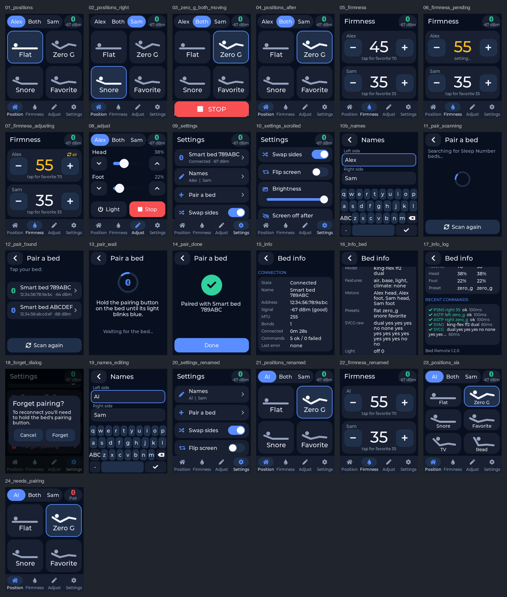

# Sleep Number Remote (ESP32 CYD)

A touchscreen remote for Sleep Number beds with "Fuzion" bases (e.g. FlexFit 2 / Climate series),
running on the ESP32-2432S028R "Cheap Yellow Display" in portrait. It talks to the bed **directly
over Bluetooth**, with no Sleep Number account, cloud or Wi-Fi. A slim, screwless 3D-printable case
is in [`case/`](case/README.md).


> Unofficial project, not affiliated with Sleep Number. Use at your own risk.

## Screens


- **Positions** (home): big pose tiles for the presets the bed supports. The header picks the left
  sleeper, both, or the right sleeper. While the base moves, the bottom bar turns into a large
  **STOP** button.
- **Firmness**: both sleepers side by side with ±5 (sent ~1 s after the last tap). Tap the number
  to go to that side's favorite; hold it to save the current number as the favorite.
- **Adjust**: head/foot sliders with ▼/▲ nudges (±10), under-bed light, stop.
- **Settings**: bed status, side names (on-screen keyboard), pair a bed, swap sides, flip screen
  (for mounting with the USB on top), brightness, screen-off timeout, Bed info, forget pairing.
- **Bed info**: connection details (signal, MTU, bonds, uptime, command counts, last error), the
  bed's reported configuration, per-side live values and a log of recent commands.

The screen dims after 30 s and turns off after the chosen timeout. When it turns off, the remote
also releases Bluetooth so the SleepIQ phone app can connect. Touch to wake. A touch on a dark
screen only wakes it.

## Hardware
- **ESP32-2432S028R** ("Cheap Yellow Display"): ESP32, 2.8" 320x240 ILI9341 display, XPT2046
  resistive touch. Sold under many brands for about $10-15.
- A **Sleep Number bed with a Fuzion base**. Run a Bluetooth scan: Fuzion beds advertise as
  `Smart bed XXXXXX` with service `09d23fae-90e6-44c2-95b6-0b3d0f1abf25`. Tested on a C4 FlexTop King
  with a FlexFit 2 base. Older i8 / 360 beds that use the "MCR" protocol are not supported.

Some boards sold as "2.8 inch CYD" use an ST7789 panel instead (often the ones with two USB ports).
If colours look wrong, change `ILI9341_2_DRIVER` in `platformio.ini`. If taps land in the wrong
place, adjust the touch calibration in `include/config.h`.

## Build & flash
Requires [PlatformIO](https://platformio.org/).
```bash
pio run -t upload
```
Serial log: `pio device monitor`.

## First use: pairing
1. Close the SleepIQ app on nearby phones. The bed accepts one Bluetooth connection at a time.
2. On the remote: **Settings → Pair a bed** and pick your bed (it appears as `Smart bed XXXXXX`).
3. Hold the bed's pairing button until its light blinks blue. The remote retries until the bed
   accepts it.

Then set the names in **Settings → Names**. If a side controls the wrong half of the bed, turn on
**Swap left / right**.

## Where data is stored
Nothing about your bed is in the source. The paired bed's address, the Bluetooth bonding keys and
all settings (names, swap, brightness, timeout) live only in the ESP32's flash (NVS). They survive
reflashing; `pio run -t erase` wipes them.

For your own builds you can seed the setting defaults in `include/config_local.h`. That file is
git-ignored; see `include/config_local.example.h`. `include/config.h` has the other build options
(timers, touch calibration).

## Security notes
- The remote only acts as a Bluetooth client. It never advertises or accepts connections, and it
  has no Wi-Fi or network code.
- Pairing with the bed uses Bluetooth LE Secure Connections "Just Works". As with the SleepIQ app,
  anyone who can put the bed into pairing mode (physical access) can pair a device.
- The bonding keys are stored unencrypted in the ESP32's flash, like most ESP32 projects. Someone
  with physical access to the board could read them out and control the bed. If a board is lost,
  clear the bed's paired Bluetooth devices (see the bed's manual or Sleep Number support). ESP32
  flash encryption would protect the keys, but it burns one-time eFuses, so it's left to you.
- Text received over the radio (bed replies, advertised names) is length-limited and reduced to
  printable ASCII before it's shown.

## UI simulator
`sim/` builds the same UI code for the desktop against a fake bed, drives it with scripted touches
and writes screenshots to `sim/out/` (2x scale):
```bash
pio run              # once, to download LVGL
make -C sim run
```

## Protocol
Commands are Fuzion "bamkey" text commands (`PSNS left 40`, `ASTP right zero_g`,
`ACTS left head 30`, `ACHA`, `UBLS high 15`, ...) framed as `fUzIoN` + length + payload + CRC32 and
written to characteristic `421e00f3-…`. After bonding, the Auth characteristic (`8d4675a5-…`) gives a
session id; the bed notifies it when a response is ready to read back. Reverse-engineering credit:
[kristofferR/ha-adjustable-bed](https://github.com/kristofferR/ha-adjustable-bed).

## License
[MIT](LICENSE)
