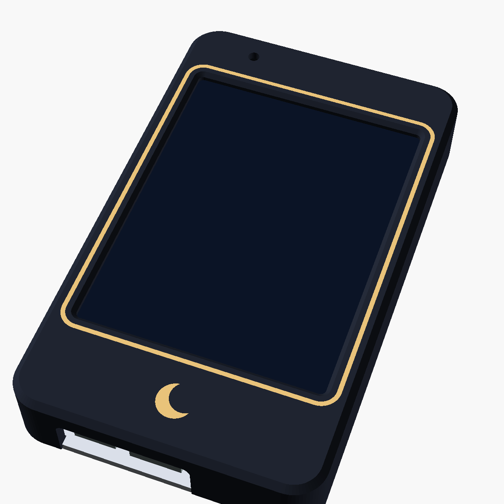

# Sleep Number Remote (ESP32 CYD)

A touchscreen remote for Sleep Number beds with "Fuzion" bases (e.g. FlexFit 2 / Climate series),
running on the ~$15 ESP32-2432S028R "Cheap Yellow Display". It talks to the bed **directly over
Bluetooth**, with no Sleep Number account or cloud.

- **Touchscreen remote**: presets, firmness, head/foot, under-bed light and stop, for each side or
  both.
- **Apple HomeKit** (optional): the presets as named switches in the Home app and Siri ("Hey Siri,
  turn on Zero G"). No hub or bridge needed.
- **Local API** (optional): JSON over HTTP, discoverable over mDNS, for Home Assistant, scripts
  and anything else on your network. See [docs/API.md](docs/API.md).
- **3D-printable case**: slim and screwless, in [`case/`](case/README.md).



> Unofficial project, not affiliated with Sleep Number. Use at your own risk.

## Screens


- **Positions** (home): big pose tiles for the presets the bed supports. The header picks the left
  sleeper, both, or the right sleeper. While the base moves, the bottom bar turns into a large
  **STOP** button.
- **Firmness**: both sleepers side by side with ±5 (sent ~1 s after the last tap). Tap the number
  to go to that side's favorite; hold it to save the current number as the favorite.
- **Adjust**: head/foot sliders with ▼/▲ nudges (±10), under-bed light, stop.
- **Settings**: bed status, side names (on-screen keyboard), pair a bed, HomeKit, swap sides, flip
  screen (for mounting with the USB on top), brightness, screen-off timeout, Bed info, forget pairing.
- **HomeKit**: on/off, Wi-Fi network picker and password keyboard, the setup code as a QR code,
  local API on/off.
- **Bed info**: connection details (signal, MTU, bonds, uptime, command counts, last error), the
  bed's reported configuration, per-side live values and a log of recent commands.

The screen dims after 30 s and turns off after the chosen timeout. When it turns off, the remote
also releases Bluetooth so the SleepIQ phone app can connect. Touch to wake. A touch on a dark
screen only wakes it.

## Hardware
- **ESP32-2432S028R** ("Cheap Yellow Display"): ESP32, 2.8" 320x240 ILI9341 display, XPT2046
  resistive touch. Sold under many brands for about $10-15.
- A **Sleep Number bed with a Fuzion base**. Run a Bluetooth scan: Fuzion beds advertise as
  `Smart bed XXXXXX` with service `09d23fae-90e6-44c2-95b6-0b3d0f1abf25`. Tested on a C4 FlexTop King
  with a FlexFit 2 base. Older i8 / 360 beds that use the "MCR" protocol are not supported.

Some boards sold as "2.8 inch CYD" use an ST7789 panel instead (often the ones with two USB ports).
If colours look wrong, change `ILI9341_2_DRIVER` in `platformio.ini`. If taps land in the wrong
place, adjust the touch calibration in `include/config.h`.

## Build & flash
Requires [PlatformIO](https://platformio.org/) (CLI or the VS Code extension). Libraries are
fetched automatically on the first build.
```bash
git clone https://github.com/giladfr/SleepNumberRemote.git
cd SleepNumberRemote
pio run -t upload        # add --upload-port /dev/cu.usbserial-XXXX if there are several ports
pio device monitor       # serial log, 115200 baud
```
Settings and pairings live in flash and survive updating the firmware. If uploads fail at the
default 460800 baud, lower `upload_speed` in `platformio.ini`.

## First use: pairing
1. Close the SleepIQ app on nearby phones. The bed accepts one Bluetooth connection at a time.
2. On the remote: **Settings → Pair a bed** and pick your bed (it appears as `Smart bed XXXXXX`).
3. Hold the bed's pairing button until its light blinks blue. The remote retries until the bed
   accepts it.

Then set the names in **Settings → Names**. If a side controls the wrong half of the bed, turn on
**Swap sides**.

## Apple HomeKit (optional)
**Settings → HomeKit**, turn on **Apple Home**, pick your Wi-Fi network (2.4 GHz) and type its
password. The remote then shows a QR code and an 8-digit setup code: in the Home app tap **+ → Add
Accessory** and scan it. The code is generated on the device; there is no shared default.

The remote appears as a bridge with these accessories:

| Accessory | Switches | Siri |
|---|---|---|
| *Name* Side (one per side) | *Name* Flat, *Name* Zero G, *Name* Snore, *Name* Favorite (and TV / Read if the base has them) | "Turn on Alex Zero G" |
| Both Sides | Flat, Zero G, Snore, Favorite: both sides at once | "Turn on Zero G" |
| Bed Light | Under-bed light (only if installed) | "Turn on the bed light" |

Siri wants "turn on": "Hey Siri, turn on Zero G" moves both sides, "turn on Alex Snore" one side,
"turn off Zero G" goes back to flat. A switch is on while the bed is in that preset; turning it off
returns to flat. Firmness and exact head/foot positions stay on the remote's screen (and the
[local API](docs/API.md)).

Scenes and automations work as usual (e.g. "Good morning" → both sides Flat); timed automations
and remote access need a home hub (Apple TV or HomePod).

Good to know:
- With the screen off the remote normally releases the bed for the SleepIQ app. A Home app command
  reconnects it for a minute, so expect 1–3 s of delay after a quiet period.
- Switch states in the Home app are as of the last time the remote was connected to the bed.
- If the Home app shows generic names like "Switch 2" (e.g. after an update that changed the
  accessories), remove "Bed Remote" in the Home app and add it again.
- Turning HomeKit off, changing Wi-Fi or resetting HomeKit restarts the remote. Renaming a side or
  the bed reporting new features restarts it quietly the next time the screen has been off for two
  minutes, so the Home app picks up the change.
- **Reset HomeKit** unpairs and makes a new setup code. Also remove "Bed Remote" in the Home app.
- The HomeKit screen shows the IP address and free memory. Wi-Fi, Bluetooth, HomeKit and the UI
  share the ESP32's ~320 KB of RAM; if anything is unstable, that number is the first thing to check.

HomeKit is implemented with [HomeSpan](https://github.com/HomeSpan/HomeSpan) 1.9 (MIT).

## Local API (optional)
While Wi-Fi is on, the remote serves a JSON API at `http://bedremote.local:8080` and advertises it
over mDNS (`_bedremote._tcp` and `_http._tcp`), so anything on your network can find it and control
the bed. HomeKit pairing isn't required, only the Wi-Fi from the HomeKit screen.
```bash
curl http://bedremote.local:8080/api/status
curl -d "side=both&preset=flat" http://bedremote.local:8080/api/preset
curl -d "side=left&value=45" http://bedremote.local:8080/api/sleep-number
curl -d "side=right&actuator=head&value=30" http://bedremote.local:8080/api/position
curl -d "on=true" http://bedremote.local:8080/api/light
curl -X POST http://bedremote.local:8080/api/stop
```
There is **no authentication**: it's meant for a trusted home network. Turn it off in
**Settings → HomeKit → Local API**. Full reference with Home Assistant, Python and Shortcuts
examples: [docs/API.md](docs/API.md).

## Where data is stored
Nothing about your bed is in the source. The paired bed's address, the Bluetooth bonding keys and
all settings (names, swap, brightness, timeout, Wi-Fi network and password, HomeKit setup code and
pairings) live only in the ESP32's flash (NVS). They survive
reflashing; `pio run -t erase` wipes them.

For your own builds you can seed the setting defaults in `include/config_local.h`. That file is
git-ignored; see `include/config_local.example.h`. `include/config.h` has the other build options
(timers, touch calibration).

## Security notes
- The remote only acts as a Bluetooth client. It never advertises or accepts Bluetooth connections.
- With HomeKit off, Wi-Fi stays off (it only turns on briefly to list networks while you set it
  up). With HomeKit on there are two network services:
  - HomeKit (HAP on port 80, with mDNS), which requires pairing with the setup code and encrypts
    every session.
  - The local API (port 8080), which is **unauthenticated plain HTTP**: any device on the network
    can read the bed's state and move it. Turn it off on the HomeKit screen if that's not what you
    want. It only parses short, length-limited requests and never echoes input back.

  HomeSpan's serial command line, web log and over-the-air updates are disabled.
- The Wi-Fi password is stored unencrypted in flash, like the Bluetooth keys below.
- Pairing with the bed uses Bluetooth LE Secure Connections "Just Works". As with the SleepIQ app,
  anyone who can put the bed into pairing mode (physical access) can pair a device.
- The bonding keys are stored unencrypted in the ESP32's flash, like most ESP32 projects. Someone
  with physical access to the board could read them out and control the bed. If a board is lost,
  clear the bed's paired Bluetooth devices (see the bed's manual or Sleep Number support). ESP32
  flash encryption would protect the keys, but it burns one-time eFuses, so it's left to you.
- Text received over the radio (bed replies, advertised names) is length-limited and reduced to
  printable ASCII before it's shown.

## Troubleshooting
- **The remote can't connect to the bed**: close the SleepIQ app on every phone nearby (the bed
  takes one Bluetooth connection at a time). **Settings → Bed info** shows the last error.
- **"No networks found"**: the ESP32 only does 2.4 GHz Wi-Fi. Scan again; the list can take a few
  seconds while Bluetooth shares the radio.
- **Generic names in the Home app** ("Switch 2"): remove "Bed Remote" in the Home app and add it
  again.
- **The remote restarts or freezes with HomeKit on**: check free memory at the bottom of the
  HomeKit screen and open an issue with the serial log (`pio device monitor`).
- **`bedremote.local` doesn't resolve**: use the IP address from the HomeKit screen.

## How the code is organized
| Path | What |
|---|---|
| `src/main.cpp` | Setup, display/touch drivers, screen power, main loop |
| `src/bed_link.*` | Bluetooth link to the bed (NimBLE): pairing, command queue, polling |
| `src/homekit.*` | HomeKit accessories (HomeSpan), Wi-Fi scan, restarts |
| `src/net_api.*` | Local HTTP API and its mDNS advertisement |
| `src/ui*.cpp` | LVGL screens (`ui_control`: presets, firmness, adjust; `ui_system`: settings, pairing, info; `ui_homekit`) |
| `src/settings.*` | Settings in NVS |
| `include/config.h` | Build options: timers, touch calibration, defaults |
| `sim/` | Desktop simulator and screenshot script |
| `case/` | 3D-printable case (OpenSCAD) |

The Bluetooth link, HomeKit and the UI run in separate FreeRTOS tasks. The UI and HomeKit only
read the bed through `BedLink::snapshot()` and send commands through `BedLink::send()`, so
everything that controls the bed goes through one queue.

## Contributing
Issues and pull requests are welcome, especially reports from other bed models (the
`Bed info` screen shows the configuration the bed reports). Please:
- check UI changes in the simulator (`make -C sim run`) and attach a screenshot,
- keep personal data (bed addresses, names, Wi-Fi details) out of commits; use
  `include/config_local.h` for your own defaults,
- note the board and bed you tested on.

## UI simulator
`sim/` builds the same UI code for the desktop against a fake bed, drives it with scripted touches
and writes screenshots to `sim/out/` (2x scale):
```bash
pio run              # once, to download LVGL
make -C sim run
```

## Protocol
Commands are Fuzion "bamkey" text commands (`PSNS left 40`, `ASTP right zero_g`,
`ACTS left head 30`, `ACHA`, `UBLS high 15`, ...) framed as `fUzIoN` + length + payload + CRC32 and
written to characteristic `421e00f3-…`. After bonding, the Auth characteristic (`8d4675a5-…`) gives a
session id; the bed notifies it when a response is ready to read back. Reverse-engineering credit:
[kristofferR/ha-adjustable-bed](https://github.com/kristofferR/ha-adjustable-bed).

## License
[MIT](LICENSE)
