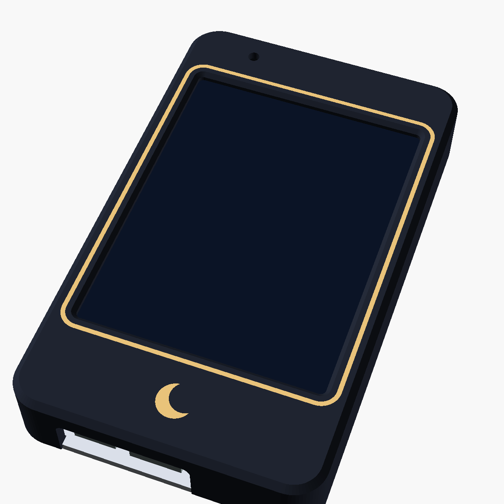

# Case

A slim (13.6 mm), two-part, press-fit case for the ESP32-2432S028R in portrait, with the USB cable
exiting at the bottom. No screws, glue or extra parts.



| Part | File | Print |
|---|---|---|
| Front shell + accent inlay | `out/front_body.stl` + `out/front_accent.stl` | face down |
| Back plate | `out/back.stl` | outer face down |
| Both, ready for Bambu Studio (any printer) | `out/cyd_case.3mf` | one plate, three filaments |
| Both, as a Bambu Lab X2D project | `out/cyd_case_x2d.3mf` | 0.20 mm Standard, 3 × PLA Matte, ~40 min |
| Fit test (face + pins only) | `out/fit_test.stl` | face down, ~20 min |

The case is made for the current board revision, with a micro-USB **and** a USB-C on the bottom
edge; one opening fits either plug.

## How it fits together
- The board drops **face down** into the front shell. Four tapered pins on the bezel standoffs go
  into the board's mounting holes and centre the screen behind the window.
- The **back plate** presses in and locks into a groove on both long sides. Its beads are one-way:
  a gentle ramp going in, a near-vertical catch against the groove coming out. Six small crush ribs
  on the top and bottom edges add friction. Its four posts, with flared bases, hold the PCB against
  the standoffs, so the display glass carries no load.
- A tab on the back plate closes the bottom of the USB opening. It keys the plate so it only fits one
  way round, and it's where you pry to open the case.
- The front has a pinhole over the board's light sensor.

Board dimensions come from the manufacturer drawing and a STEP model of the board (from the
[CYD community repo](https://github.com/witnessmenow/ESP32-Cheap-Yellow-Display)). A collision check
against that model shows zero overlap with both parts, apart from the intended 0.1 mm post preload.

## Printing
- Any PLA/PETG, 0.2 mm layers, 3 walls, 15 % infill, **no supports**. Under 25 g for both parts.
- Print the front face down. A textured PEI plate gives a matte finish; a smooth plate gives a gloss
  face.
- **Three filament slots**, so each can be its own colour or share one:
  1. front shell
  2. back plate
  3. accent ring around the screen + moon in the bottom bezel (the first 0.6 mm, 3 layers, of the
     face-down print)

  To use fewer colours, set two slots to the same filament in Bambu Studio. When you open
  `cyd_case.3mf` into an existing project, make sure it has at least three filaments (sync the
  AMS); otherwise reassign the parts in the object list.
- `cyd_case_x2d.3mf` is a complete project for the **Bambu Lab X2D**: printer, process and three
  filament slots are set, and the build checks that it slices using all three. On a dual-nozzle
  printer only the three accent layers need filament swaps. With a single nozzle plus AMS, moving
  the back plate to its own plate avoids a swap on every layer.
- For a plain face without the accent recess, set `accent = false; moon = false;` and rebuild.
- First time? Print `fit_test.stl` (the face and pins only) and press the board in. It checks the
  outline, window position and hole spacing before the 1 h+ full print.

## Assembly
1. Lay the front shell face down. Drop the board in face down, with the USB end at the opening; the
   pins go into the board's holes.
2. Press the back plate in, tab toward the USB opening, until both long sides click.
3. To open, push a fingernail or a small flat screwdriver under the tab and pry it up.

## Mounting
The back has two keyhole slots, 32 mm apart. Use screws or nails with heads up to Ø7 mm and 2 mm tall,
left about 1 mm out from the wall. Set `keyholes = false` in the SCAD file for a plain back, for
example when using adhesive strips.

## Customising
Edit `cyd_case.scad` (OpenSCAD 2025+ recommended) and rebuild everything with the command below.
The X2D project is only built when Bambu Studio is installed (macOS path in `build.py`).
```bash
python3 case/build.py
```
Useful parameters:
- `clr`: board-to-wall clearance (default 0.20 mm)
- `plate_clr`: back-plate clearance (0.15 mm)
- `bead`: snap strength (0.45 mm); `crush`: crush-rib interference (0.25 mm)
- `wall`, `face`, `outer_r`, `edge_chamfer`: shape
- `accent`, `moon`, `sensor_hole`, `keyholes`: features

The `part` variable also offers `assembly`, `section` and `exploded` views.
